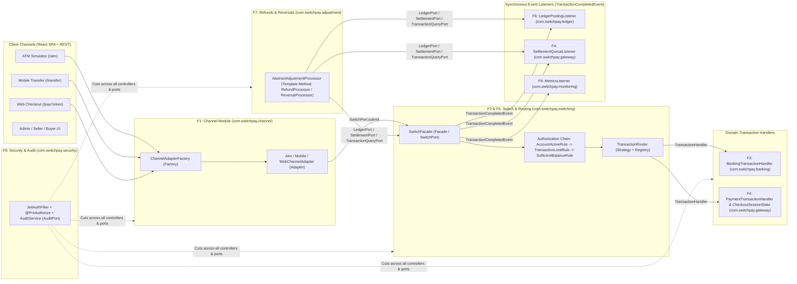

# SwitchPay — Multi-Channel Banking and Payment Switch

> **CSE 3220 — Software Engineering Lab Project**  
> **Repository**: [https://github.com/ShahMakhdumSharif/SwitchPay](https://github.com/ShahMakhdumSharif/SwitchPay)  
> **Live Deployment (Render)**: `https://switchpay.onrender.com` *(health check: `/actuator/health`)*

---

## 1. Project Description

**SwitchPay** is a modular-monolith banking and payment switching platform built with **Java 21**, **Spring Boot 3**, **PostgreSQL 16 (Flyway)**, **Spring Security (stateless JWT + BCrypt + `@PreAuthorize`)**, and a **React 18 + Vite + Tailwind CSS** single-page frontend packaged into a single multi-stage Docker deployable.

Customer transactions originating from simulated **ATM terminals**, **Mobile banking apps**, and **Merchant Web Checkout sessions** are normalized into a canonical request and routed through a centralized transaction switch that enforces idempotency, pre-authorization rules, handler routing, double-entry ledger posting, merchant settlement, refunds/reversals, and real-time operational monitoring.

### Nine Core Features (`F1`–`F9`)

| Feature ID | Feature Name | Package (`com.switchpay.*`) | Owner | Summary |
| :--- | :--- | :--- | :--- | :--- |
| **F1** | Multi-Channel Access | `channel` | Ruhan | Channel registry CRUD (`ATM`, `MOBILE`, `WEB`), channel adapters & factory normalizing requests into `SwitchPort`. |
| **F2** | Centralized Transaction Switch | `switching` | Sharif | `SwitchFacade` managing idempotency, `PENDING` lifecycle creation, synchronous `TransactionCompletedEvent` publication, and query port. |
| **F3** | Core Banking Accounts | `banking` | Sakal | Customer & system accounts (`SAVINGS`, `CURRENT`), optimistic locking, balance inquiry, and `BankingTransactionHandler`. |
| **F4** | Payment Gateway & Settlement | `gateway` | Ruhan | Merchant onboarding, `CheckoutSession` state machine (`CREATED` -> `PAID`/`EXPIRED`/`CANCELLED`), web checkout payment handler, and batch settlement runs. |
| **F5** | Routing & Authorization Engine | `switching` | Sharif | Chain of Responsibility (`AccountActiveRule`, `TransactionLimitRule`, `SufficientBalanceRule`) and Strategy-based `TransactionRouter`. |
| **F6** | Double-Entry Ledger | `ledger` | Sakal | Immutable `LedgerEntry` records assembled via `PostingRequest.builder()`, enforcing balanced debit/credit lines on every money movement. |
| **F7** | Refunds & Reversals | `adjustment` | Sakal | `AbstractAdjustmentProcessor` template method driving `RefundProcessor` (partial/full merchant refunds) and `ReversalProcessor` (single ATM/transfer reversal). |
| **F8** | Security, RBAC & Audit Trail | `security` | Sharif | Stateless HS256 JWT authentication, token revocation (`revoked_tokens`), method-level `@PreAuthorize`, uniform `ApiError`, and `AuditPort` logging. |
| **F9** | Operational Monitoring | `monitoring` | Ruhan | Admin operations summary, stuck/failed transaction queries, and Micrometer metrics (`switchpay.transactions`, `switchpay.switch.latency`). |

### Roles (`ADMIN`, `SELLER`, `BUYER`)

- **`BUYER` (Customer)**: View own bank accounts and real-time BDT balances, perform ATM cash withdrawals/inquiries, initiate mobile account-to-account transfers, pay merchant checkout sessions, and inspect personal transaction history.
- **`SELLER` (Merchant)**: Register and manage merchant profile, create timed checkout sessions with shareable payment links (`#/pay/{token}`), view settlement history, and issue partial or full refunds on paid checkout transactions.
- **`ADMIN` (Operations & Platform Admin)**: Full platform visibility — manage users, accounts, channels, and merchants; inspect double-entry ledger statements; execute settlement batches; trigger transaction reversals/refunds; monitor failed/stuck transactions and audit logs.

---

## 2. Architecture, Modules, Ports & Design Patterns

### Modular Monolith & Boundary Rule

SwitchPay is structured as one Maven deployable containing nine domain modules plus a shared kernel (`com.switchpay.common`).

- **Strict Boundary Rule**: Inside a module, standard layered architecture applies (`controller`, `service`, `repository`, `entity`, `dto`). **Across modules, code communicates exclusively through `com.switchpay.common.port.*` interfaces and `com.switchpay.common.event.*` domain events** — never importing another module's repository or entity. Cross-module foreign references are stored by plain ID.



*(Mermaid source also available in [`docs/architecture.mmd`](docs/architecture.mmd).)*

### Cross-Module Port & Event Contracts

| Contract | Defined By | Implemented By | Used By | Purpose |
| :--- | :--- | :--- | :--- | :--- |
| `AccountPort` | Sharif (`common.port`) | Sakal (`banking`) | Switch auth chain, payment handler | Account validation, balance inquiry, atomic debit/credit in BDT. |
| `TransactionHandler` | Sharif (`common.port`) | Sakal (`banking`), Ruhan (`gateway`) | `TransactionRouter` (`switching`) | Strategy contract for executing validated transactions by `TransactionType`. |
| `SwitchPort` | Sharif (`common.port`) | Sharif (`SwitchFacade`) | Ruhan's channel adapters (`channel`) | Single entrypoint (`submit(TransactionRequest)`) into the centralized switch. |
| `TransactionQueryPort` | Sharif (`common.port`) | Sharif (`SwitchFacade`) | Adjustments (`adjustment`), Monitoring & Settlement | Lookup by reference, paged filtered search, and status transitions (`markStatus`). |
| `LedgerPort` | Sharif (`common.port`) | Sakal (`LedgerService`) | Adjustments (`adjustment`), Settlement (`gateway`) | Post balanced double-entry lines and generate opposing reversal/refund entries. |
| `SettlementPort` | Sharif (`common.port`) | Ruhan (`SettlementService`) | Refunds (`adjustment`) | Adjust merchant settlement payables when a paid transaction is refunded. |
| `AuditPort` | Sharif (`common.port`) | Sharif (`AuditService`) | All modules | Record immutable security and business audit events in `audit_logs`. |
| `TransactionCompletedEvent` | Sharif (`common.event`) | Published by `SwitchFacade` | `LedgerPostingListener`, `SettlementQueueListener`, `MetricsListener` | Fired synchronously inside the switch DB transaction so ledger postings and status changes commit or roll back atomically. |

### Nine Documented Design Patterns

| # | Design Pattern | Where Implemented (Class Names) | Owner | Problem Solved |
| :-: | :--- | :--- | :--- | :--- |
| 1 | **Facade** | `com.switchpay.switching.service.SwitchFacade` | Sharif | Hides idempotency check, `PENDING` persistence, authorization chain evaluation, handler routing, audit logging, and synchronous event publication behind `SwitchPort.submit()`. |
| 2 | **Chain of Responsibility** | `com.switchpay.switching.auth.AuthorizationRule`, `AccountActiveRule`, `TransactionLimitRule`, `SufficientBalanceRule` | Sharif | Evaluates ordered pre-authorization rules before routing; any rule can short-circuit with `DECLINED` and a clear business reason. |
| 3 | **Strategy + Registry** | `com.switchpay.common.port.TransactionHandler`, `com.switchpay.switching.router.TransactionRouter`, `BankingTransactionHandler`, `PaymentTransactionHandler` | Sharif, Sakal, Ruhan | Decouples the switch from domain execution by selecting the matching `TransactionHandler` strategy for each `TransactionType` at runtime. |
| 4 | **Observer** | `com.switchpay.common.event.TransactionCompletedEvent`, `LedgerPostingListener`, `SettlementQueueListener`, `MetricsListener` | Sharif, Sakal, Ruhan | Broadcasts completed transactions synchronously to ledger posting, settlement queueing, and Micrometer telemetry without coupling the switch to downstream modules. |
| 5 | **Adapter** | `com.switchpay.channel.adapter.ChannelAdapter`, `AtmChannelAdapter`, `MobileChannelAdapter`, `WebChannelAdapter` | Ruhan | Translates channel-specific REST payloads (ATM, Mobile, Web Checkout) into the canonical `TransactionRequest` consumed by `SwitchPort`. |
| 6 | **Factory** | `com.switchpay.channel.adapter.ChannelAdapterFactory` | Ruhan | Resolves the appropriate `ChannelAdapter` by channel code (`ATM`, `MOBILE`, `WEB`) and rejects unknown or inactive channels with HTTP `422`. |
| 7 | **State** | `com.switchpay.gateway.state.CheckoutSessionState` (`CREATED` -> `PAID` / `EXPIRED` / `CANCELLED`) | Ruhan | Centralizes legal checkout session lifecycle transitions and prevents invalid double-payment or paying expired sessions. |
| 8 | **Builder** | `com.switchpay.common.port.PostingRequest.builder()`, `com.switchpay.ledger.entity.LedgerEntry` builder | Sakal | Constructs immutable, multi-line double-entry ledger posting requests and entities fluently before validating `debits == credits`. |
| 9 | **Template Method** | `com.switchpay.adjustment.service.AbstractAdjustmentProcessor`, `RefundProcessor`, `ReversalProcessor` | Sakal | Defines the invariant adjustment skeleton (validate original transaction -> post opposing ledger lines -> update status -> record audit) while subclasses customize refund vs. reversal rules. |

---

## 3. Database Design & ER Diagram

> *Placeholder (Sakal — `docs/readme-er-run`)*: ER diagram (`docs/er-diagram.png`), 14 PostgreSQL tables managed by Flyway (`V1`–`V7`), entity relationships (`1:1`, `1:M`, `M:M`), and Flyway migration table will be added in `docs/readme-er-run`.

---

## 4. API Endpoints & Postman Collection

> *Placeholder (Ruhan — `docs/readme-api-monitoring`)*: Complete grouped REST API table (method, path, `@PreAuthorize` role, purpose, contracts `C1`–`C7`) and Postman collection instructions (`docs/postman/`) will be added in `docs/readme-api-monitoring`.

---

## 5. Run Instructions

> *Placeholder (Sakal — `docs/readme-er-run`)*: Full prerequisites, `.env.example` -> `.env` configuration, `docker compose up --build` single-command startup, default seeded accounts, and local Vite + Spring Boot development loop will be expanded in `docs/readme-er-run`.

Quick verification:
```bash
cp .env.example .env
docker compose up --build
```
- **Application UI & API**: `http://localhost:8080/`
- **Health Check**: `http://localhost:8080/actuator/health`

---

## 6. CI/CD Pipeline, Git Workflow & Deployment

- **Branching Model**:
  - `main`: Production branch deployed to Render, protected by the **`protect-main`** GitHub ruleset (no direct push, empty bypass list, PR required with 1 teammate approval, required status checks `build-and-test` and `docker-build`, merge commit only).
  - `develop`: Integration branch protected by team rules and local `pushRemote = no_push` guard. All feature, chore, test, docs, and fix branches (`feature/*`, `chore/*`, `test/*`, `docs/*`, `fix/*`) branch from `origin/develop` and merge back via Pull Request using **Squash and merge** after teammate approval and green CI.
- **GitHub Actions (`.github/workflows/ci-cd.yml`)**:
  1. `build-and-test`: Spins up a `postgres:16` service container, runs Flyway migrations and `mvn -B verify` (unit + integration tests), and uploads Surefire test reports.
  2. `docker-build`: Builds the multi-stage Docker image (Node 20 frontend build + Maven 3.9/JDK 21 backend build + non-root JRE 21 runtime), starts the stack via `docker compose up -d --build`, and verifies `/actuator/health` and the React SPA at `/`.
  3. `deploy`: Triggers the Render Deploy Hook on `main` pushes after both checks succeed and runs a live smoke test against `${{ vars.LIVE_URL }}/actuator/health`.

---

## 7. Frontend Architecture

- **Stack**: React 18, Vite 5, React Router 6 (`HashRouter`), Axios, Tailwind CSS 3.
- **Same-Origin Delivery**: Built inside stage 1 (`node:20-alpine`) of the multi-stage `Dockerfile` and copied into `src/main/resources/static` so Spring Boot serves both the SPA (`/`) and REST API (`/api/**`) on a single port with zero CORS complexity.
- **Auth & Security Trade-Off**: The JWT is held in `sessionStorage` (tab-scoped, cleared on `401` or `POST /api/auth/logout`). Client-side `ProtectedRoute` guards provide role-based UX, while server-side `@PreAuthorize` on every controller method enforces real authorization.

---

## 8. Testing Summary

> *Placeholder (Finalized on Day 4/5)*: Target **24 Unit Tests** (JUnit 5 + Mockito) and **15 Integration Tests** (`@SpringBootTest` + `MockMvc` against real PostgreSQL 16 + `EndToEndFlowIT` covering scenarios `E1`–`E7`). Run locally with:
> ```bash
> mvn -B verify
> ```

---

## 9. Operational Monitoring & Second Deployment (Bonus)

> *Placeholders (Ruhan & Sakal — Day 4/5)*:
> - **Monitoring (`chore/monitoring-stack`)**: Spring Boot Actuator, Micrometer Prometheus registry on port `8081` (`docker` profile), and provisioned Grafana dashboard (`docker compose --profile monitoring up --build`).
> - **Second Deployment (`docs/readme-second-deploy`)**: Verification of the identical Docker image running on a secondary cloud platform.
