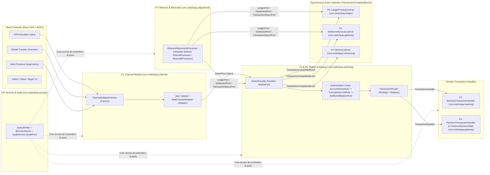

# SwitchPay — Multi-Channel Banking and Payment Switch

> **CSE 3220 — Software Engineering Lab Project**  
> **Repository**: [https://github.com/ShahMakhdumSharif/SwitchPay](https://github.com/ShahMakhdumSharif/SwitchPay)  
> **Live Deployment (Render)**: `https://switchpay.onrender.com` *(health check: `/actuator/health`)*

---

## 1. Project Description

**SwitchPay** is a modular-monolith banking and payment switching platform built with **Java 21**, **Spring Boot 3**, **PostgreSQL 16 (Flyway)**, **Spring Security (stateless JWT + BCrypt + `@PreAuthorize`)**, and a **React 18 + Vite + Tailwind CSS** single-page frontend packaged into a single multi-stage Docker deployable.

Customer transactions originating from simulated **ATM terminals**, **Mobile banking apps**, and **Merchant Web Checkout sessions** are normalized into a canonical request and routed through a centralized transaction switch that enforces idempotency, pre-authorization rules, handler routing, double-entry ledger posting, merchant settlement, refunds/reversals, and real-time operational monitoring.

### Nine Core Features (`F1`–`F9`)

| Feature ID | Feature Name | Package (`com.switchpay.*`) | Owner | Summary |
| :--- | :--- | :--- | :--- | :--- |
| **F1** | Multi-Channel Access | `channel` | Ruhan | Channel registry CRUD (`ATM`, `MOBILE`, `WEB`), channel adapters & factory normalizing requests into `SwitchPort`. |
| **F2** | Centralized Transaction Switch | `switching` | Sharif | `SwitchFacade` managing idempotency, `PENDING` lifecycle creation, synchronous `TransactionCompletedEvent` publication, and query port. |
| **F3** | Core Banking Accounts | `banking` | Sakal | Customer & system accounts (`SAVINGS`, `CURRENT`), optimistic locking, balance inquiry, and `BankingTransactionHandler`. |
| **F4** | Payment Gateway & Settlement | `gateway` | Ruhan | Merchant onboarding, `CheckoutSession` state machine (`CREATED` -> `PAID`/`EXPIRED`/`CANCELLED`), web checkout payment handler, and batch settlement runs. |
| **F5** | Routing & Authorization Engine | `switching` | Sharif | Chain of Responsibility (`AccountActiveRule`, `TransactionLimitRule`, `SufficientBalanceRule`) and Strategy-based `TransactionRouter`. |
| **F6** | Double-Entry Ledger | `ledger` | Sakal | Immutable `LedgerEntry` records assembled via `PostingRequest.builder()`, enforcing balanced debit/credit lines on every money movement. |
| **F7** | Refunds & Reversals | `adjustment` | Sakal | `AbstractAdjustmentProcessor` template method driving `RefundProcessor` (partial/full merchant refunds) and `ReversalProcessor` (single ATM/transfer reversal). |
| **F8** | Security, RBAC & Audit Trail | `security` | Sharif | Stateless HS256 JWT authentication, token revocation (`revoked_tokens`), method-level `@PreAuthorize`, uniform `ApiError`, and `AuditPort` logging. |
| **F9** | Operational Monitoring | `monitoring` | Ruhan | Admin operations summary, stuck/failed transaction queries, and Micrometer metrics (`switchpay.transactions`, `switchpay.switch.latency`). |

### Roles (`ADMIN`, `SELLER`, `BUYER`)

- **`BUYER` (Customer)**: View own bank accounts and real-time BDT balances, perform ATM cash withdrawals/inquiries, initiate mobile account-to-account transfers, pay merchant checkout sessions, and inspect personal transaction history.
- **`SELLER` (Merchant)**: Register and manage merchant profile, create timed checkout sessions with shareable payment links (`#/pay/{token}`), view settlement history, and issue partial or full refunds on paid checkout transactions.
- **`ADMIN` (Operations & Platform Admin)**: Full platform visibility — manage users, accounts, channels, and merchants; inspect double-entry ledger statements; execute settlement batches; trigger transaction reversals/refunds; monitor failed/stuck transactions and audit logs.

---

## 2. Architecture, Modules, Ports & Design Patterns

### Modular Monolith & Boundary Rule

SwitchPay is structured as one Maven deployable containing nine domain modules plus a shared kernel (`com.switchpay.common`).

- **Strict Boundary Rule**: Inside a module, standard layered architecture applies (`controller`, `service`, `repository`, `entity`, `dto`). **Across modules, code communicates exclusively through `com.switchpay.common.port.*` interfaces and `com.switchpay.common.event.*` domain events** — never importing another module's repository or entity. Cross-module foreign references are stored by plain ID.



*(Mermaid source also available in [`docs/architecture.mmd`](docs/architecture.mmd).)*

### Cross-Module Port & Event Contracts

| Contract | Defined By | Implemented By | Used By | Purpose |
| :--- | :--- | :--- | :--- | :--- |
| `AccountPort` | Sharif (`common.port`) | Sakal (`banking`) | Switch auth chain, payment handler | Account validation, balance inquiry, atomic debit/credit in BDT. |
| `TransactionHandler` | Sharif (`common.port`) | Sakal (`banking`), Ruhan (`gateway`) | `TransactionRouter` (`switching`) | Strategy contract for executing validated transactions by `TransactionType`. |
| `SwitchPort` | Sharif (`common.port`) | Sharif (`SwitchFacade`) | Ruhan's channel adapters (`channel`) | Single entrypoint (`submit(TransactionRequest)`) into the centralized switch. |
| `TransactionQueryPort` | Sharif (`common.port`) | Sharif (`SwitchFacade`) | Adjustments (`adjustment`), Monitoring & Settlement | Lookup by reference, paged filtered search, and status transitions (`markStatus`). |
| `LedgerPort` | Sharif (`common.port`) | Sakal (`LedgerService`) | Adjustments (`adjustment`), Settlement (`gateway`) | Post balanced double-entry lines and generate opposing reversal/refund entries. |
| `SettlementPort` | Sharif (`common.port`) | Ruhan (`SettlementService`) | Refunds (`adjustment`) | Adjust merchant settlement payables when a paid transaction is refunded. |
| `AuditPort` | Sharif (`common.port`) | Sharif (`AuditService`) | All modules | Record immutable security and business audit events in `audit_logs`. |
| `TransactionCompletedEvent` | Sharif (`common.event`) | Published by `SwitchFacade` | `LedgerPostingListener`, `SettlementQueueListener`, `MetricsListener` | Fired synchronously inside the switch DB transaction so ledger postings and status changes commit or roll back atomically. |

### Nine Documented Design Patterns

| # | Design Pattern | Where Implemented (Class Names) | Owner | Problem Solved |
| :-: | :--- | :--- | :--- | :--- |
| 1 | **Facade** | `com.switchpay.switching.service.SwitchFacade` | Sharif | Hides idempotency check, `PENDING` persistence, authorization chain evaluation, handler routing, audit logging, and synchronous event publication behind `SwitchPort.submit()`. |
| 2 | **Chain of Responsibility** | `com.switchpay.switching.auth.AuthorizationRule`, `AccountActiveRule`, `TransactionLimitRule`, `SufficientBalanceRule` | Sharif | Evaluates ordered pre-authorization rules before routing; any rule can short-circuit with `DECLINED` and a clear business reason. |
| 3 | **Strategy + Registry** | `com.switchpay.common.port.TransactionHandler`, `com.switchpay.switching.router.TransactionRouter`, `BankingTransactionHandler`, `PaymentTransactionHandler` | Sharif, Sakal, Ruhan | Decouples the switch from domain execution by selecting the matching `TransactionHandler` strategy for each `TransactionType` at runtime. |
| 4 | **Observer** | `com.switchpay.common.event.TransactionCompletedEvent`, `LedgerPostingListener`, `SettlementQueueListener`, `MetricsListener` | Sharif, Sakal, Ruhan | Broadcasts completed transactions synchronously to ledger posting, settlement queueing, and Micrometer telemetry without coupling the switch to downstream modules. |
| 5 | **Adapter** | `com.switchpay.channel.adapter.ChannelAdapter`, `AtmChannelAdapter`, `MobileChannelAdapter`, `WebChannelAdapter` | Ruhan | Translates channel-specific REST payloads (ATM, Mobile, Web Checkout) into the canonical `TransactionRequest` consumed by `SwitchPort`. |
| 6 | **Factory** | `com.switchpay.channel.adapter.ChannelAdapterFactory` | Ruhan | Resolves the appropriate `ChannelAdapter` by channel code (`ATM`, `MOBILE`, `WEB`) and rejects unknown or inactive channels with HTTP `422`. |
| 7 | **State** | `com.switchpay.gateway.state.CheckoutSessionState` (`CREATED` -> `PAID` / `EXPIRED` / `CANCELLED`) | Ruhan | Centralizes legal checkout session lifecycle transitions and prevents invalid double-payment or paying expired sessions. |
| 8 | **Builder** | `com.switchpay.common.dto.PostingRequest.builder()`, `com.switchpay.ledger.entity.LedgerEntry` builder | Sakal | Constructs immutable, multi-line double-entry ledger posting requests and entities fluently before validating `debits == credits`. |
| 9 | **Template Method** | `com.switchpay.adjustment.service.AbstractAdjustmentProcessor`, `RefundProcessor`, `ReversalProcessor` | Sakal | Defines the invariant adjustment skeleton (validate original transaction -> post opposing ledger lines -> update status -> record audit) while subclasses customize refund vs. reversal rules. |

---

## 3. Database Design & ER Diagram

SwitchPay uses **PostgreSQL 16** with **Flyway** owning all schema migrations (`spring.jpa.hibernate.ddl-auto=validate`). Merged migrations are never edited; subsequent changes use `V8+`.


### Tables & Key Relationships (14 Tables)

| Table | Owner | Key Columns | Relationships |
| :--- | :--- | :--- | :--- |
| `roles` | Sharif | `id`, `name` (`ADMIN`, `SELLER`, `BUYER`) | `M:M` with `users` via `user_roles` |
| `users` | Sharif | `id`, `email` (unique), `password_hash`, `full_name`, `active`, `created_at` | `M:M` `roles`; `1:M` `accounts`; `1:1` `merchants` |
| `user_roles` | Sharif | `user_id`, `role_id` | Join table (`users` <-> `roles`) |
| `revoked_tokens` | Sharif | `token_id` (`jti`), `expires_at` | Stores revoked JWT IDs on logout |
| `audit_logs` | Sharif | `id`, `actor_user_id`, `action`, `target`, `details`, `created_at` | `M:1` `users` |
| `accounts` | Sakal | `id`, `account_no` (unique), `user_id`, `type`, `balance numeric(19,2)`, `status`, `currency`, `version` | `M:1` `users`; `1:M` `ledger_entries`, `transactions` |
| `channels` | Ruhan | `id`, `code` (unique), `type`, `name`, `location`, `status` | `1:M` `transactions` |
| `merchants` | Ruhan | `id`, `user_id` (unique), `business_name`, `settlement_account_no`, `status` | `1:1` `users`; `1:M` `checkout_sessions`, `settlements` |
| `checkout_sessions` | Ruhan | `id`, `token` (unique), `merchant_id`, `amount`, `currency`, `status`, `expires_at` | `M:1` `merchants`; `1:M` `transactions` |
| `transactions` | Sharif | `id`, `reference` (unique), `idempotency_key` (unique), `type`, `channel_id`, `status`, `amount`, `source_account_id`, `destination_account_id`, `merchant_id`, `checkout_session_id`, `decline_reason` | `M:1` `accounts`, `channels`, `merchants`, `checkout_sessions`; `1:M` `ledger_entries`, `transaction_adjustments` |
| `ledger_entries` | Sakal | `id`, `transaction_id`, `account_id`, `entry_type` (`DEBIT`/`CREDIT`), `amount`, `adjustment_id` (nullable), `created_at` | `M:1` `transactions`, `accounts`, `transaction_adjustments` |
| `transaction_adjustments` | Sakal | `id`, `original_transaction_id`, `type` (`REFUND`/`REVERSAL`), `amount`, `reason`, `status`, `created_by` | `M:1` `transactions` |
| `settlements` | Ruhan | `id`, `merchant_id`, `period_date`, `total_amount`, `status` | `M:1` `merchants`; `M:M` `transactions` |
| `settlement_items` | Ruhan | `settlement_id`, `transaction_id`, `amount` | Join table (`settlements` <-> `transactions`) |

### Flyway Migration Order

| Version | File | Owner | Purpose |
| :--- | :--- | :--- | :--- |
| `V1` | `V1__security_schema.sql` | Sharif | `roles`, `users`, `user_roles`, `revoked_tokens`, `audit_logs` |
| `V2` | `V2__banking_schema.sql` | Sakal | `accounts` |
| `V3` | `V3__channels_merchants_schema.sql` | Ruhan | `channels`, `merchants`, `checkout_sessions` |
| `V4` | `V4__switch_schema.sql` | Sharif | `transactions` |
| `V5` | `V5__ledger_adjustments_schema.sql` | Sakal | `ledger_entries`, `transaction_adjustments` |
| `V6` | `V6__settlements_schema.sql` | Ruhan | `settlements`, `settlement_items` |
| `V7` | `V7__seed_reference_data.sql` | Sharif | Default roles (`ADMIN`, `SELLER`, `BUYER`), system accounts (`SYS-CASH`, `SYS-MERCHANT-PAYABLE`), default channels (`ATM`, `MOBILE`, `WEB`) |

---

## 4. API Endpoints & Postman Collection

All controllers enforce `@PreAuthorize` at the method level and return uniform `ApiError` JSON (`{timestamp, status, error, message, path, fieldErrors[]}`) via a single `@RestControllerAdvice`.

### Security & Switch Endpoints (`Sharif`)

| Method | Path | Access | Purpose |
| :--- | :--- | :--- | :--- |
| `POST` | `/api/auth/register` | `permitAll` | Register `BUYER` or `SELLER` account (BCrypt) |
| `POST` | `/api/auth/login` | `permitAll` | Authenticate and return `{token, expiresAt, user:{id,email,fullName,roles[]}}` (C1) |
| `POST` | `/api/auth/logout` | Authenticated | Revoke JWT `jti` in `revoked_tokens` |
| `GET` / `PUT` / `DELETE` | `/api/users`, `/api/users/{id}` | `ADMIN` (own profile `GET`: any) | User CRUD; `DELETE` soft-deactivates |
| `POST` | `/api/transactions` | `BUYER`, `ADMIN` | Submit canonical transaction through `SwitchPort` (C4) |
| `GET` | `/api/transactions` | `BUYER` (own), `ADMIN` (all) | Paged filtered list (`page`, `size`, `status`, `channel`, `from`, `to`) (C3) |
| `GET` | `/api/transactions/{ref}` | Owner or `ADMIN` | Transaction detail and status tracking |
| `GET` | `/actuator/health`, `/actuator/info` | `permitAll` | Container and Render health check |

### Core Banking, Ledger & Adjustments (`Sakal`)

| Method | Path | Access | Purpose |
| :--- | :--- | :--- | :--- |
| `POST` | `/api/accounts` | `ADMIN` | Create customer account |
| `GET` | `/api/accounts`, `/api/accounts/{no}` | `BUYER` (own), `ADMIN` (all) | Account lookup |
| `PUT` / `DELETE` | `/api/accounts/{no}` | `ADMIN` | Update status/limits; `DELETE` soft-closes |
| `GET` | `/api/accounts/{no}/balance` | `BUYER` (own), `ADMIN` | Real-time balance inquiry |
| `GET` | `/api/ledger/entries?transactionRef=` | `ADMIN` | Balanced double-entry lines for a transaction |
| `GET` | `/api/ledger/accounts/{no}` | `ADMIN` | Account ledger statement |
| `POST` | `/api/adjustments/refunds` | `ADMIN`, `SELLER` (own) | Partial/full refund (`422` on over-refund) |
| `POST` | `/api/adjustments/reversals` | `ADMIN` | Reverse unsettled transaction (`409` on second attempt) |
| `GET` | `/api/adjustments` | `ADMIN` | List adjustments |

### Channels, Payment Gateway & Monitoring (`Ruhan`)

| Method | Path | Access | Purpose |
| :--- | :--- | :--- | :--- |
| `POST` / `GET` / `PUT` / `DELETE` | `/api/channels` | `ADMIN` | Channel registry CRUD |
| `POST` | `/api/channels/atm/transactions` | `BUYER` | ATM withdrawal, balance inquiry, validation (C4) |
| `POST` | `/api/channels/mobile/transactions` | `BUYER` | Mobile transfer, balance inquiry, validation (C4) |
| `POST` | `/api/channels/web/checkout/{token}/pay` | `BUYER` | Pay merchant checkout session |
| `POST` / `GET` / `PUT` / `DELETE` | `/api/merchants` | `SELLER` (own), `ADMIN` (all) | Merchant CRUD (`409` on duplicate) |
| `POST` / `GET` | `/api/checkout-sessions` | `SELLER` | Create/list own checkout sessions (includes `transactionRef` once `PAID`, C6) |
| `GET` | `/api/checkout-sessions/{token}` | `SELLER` (own), `BUYER` | Public checkout summary before paying (C5) |
| `GET` / `POST` | `/api/settlements`, `/api/settlements/run` | `SELLER` (own list), `ADMIN` (run) | Settlement history and batch execution |
| `GET` | `/api/ops/transactions`, `/summary`, `/failed`, `/stuck`, `/audit-logs` | `ADMIN` | Operational monitoring and audit log viewer |

- **Postman Collection**: Import [`docs/postman/`](docs/postman/) for pre-configured module folders, environment variables, and the end-to-end smoke folder.

---

## 5. Run Instructions

### Prerequisites

- **Docker** & **Docker Compose** (for single-command full-stack run)
- **Java 21**, **Maven 3.9+**, and **Node.js 20+** (for local development/testing)

### Single-Command Docker Run (Production-Equivalent)

```bash
cp .env.example .env
# Edit .env if needed (no secrets are committed to Git)
docker compose up --build
```

- **Frontend UI & Backend API**: `http://localhost:8080/`
- **Health Check**: `http://localhost:8080/actuator/health`

### Local Development Loop (Hot Reload)

1. **Terminal 1 — PostgreSQL + Spring Boot**:
   ```bash
   docker compose up -d db
   export SPRING_DATASOURCE_URL=jdbc:postgresql://localhost:5432/switchpay
   export SPRING_DATASOURCE_USERNAME=switchpay
   export SPRING_DATASOURCE_PASSWORD=change-me
   export JWT_SECRET=local-dev-secret-at-least-32-characters
   export ADMIN_EMAIL=admin@switchpay.local
   export ADMIN_PASSWORD=change-me
   mvn spring-boot:run
   ```
2. **Terminal 2 — Vite Dev Server**:
   ```bash
   cd frontend
   npm install
   npm run dev
   ```
   Open `http://localhost:5173/` (Vite proxies `/api` to `http://localhost:8080`).

### Environment Variables (`.env.example`)

All secrets are injected via environment variables; `application.yml` contains `${ENV}` placeholders only.

| Variable | Purpose |
| :--- | :--- |
| `POSTGRES_DB`, `POSTGRES_USER`, `POSTGRES_PASSWORD` | PostgreSQL container & datasource credentials |
| `SPRING_DATASOURCE_URL`, `_USERNAME`, `_PASSWORD` | Spring Boot JDBC connection (set by Compose / Render) |
| `JWT_SECRET`, `JWT_EXPIRATION_MINUTES` | HS256 signing key (32+ chars) and token TTL |
| `ADMIN_EMAIL`, `ADMIN_PASSWORD` | Initial `ADMIN` account created by `AdminBootstrap` |
| `PORT` / `APP_PORT` | HTTP server port (`8080` default; injected by Render) |
| `GRAFANA_ADMIN_PASSWORD` | Grafana admin password when running `--profile monitoring` |

---

## 6. CI/CD Pipeline, Git Workflow & Deployment

### Branching Strategy & Protection Rules

- **`main`**: Production branch deployed automatically to Render. Protected by the **single GitHub ruleset `protect-main`**:
  - Active enforcement with an **empty bypass list** (even the repository owner cannot push directly).
  - Requires a Pull Request with **1 teammate approval**, **dismisses stale approvals** on new pushes, requires **conversation resolution**, and allows **Merge commits only**.
  - Requires status checks **`build-and-test`** and **`docker-build`** to pass and the branch to be **up to date** before merging.
- **`develop`**: Integration branch protected by **team rules and PR discipline** (not by a GitHub ruleset), plus local `branch.develop.pushRemote = no_push` guards. Every `feature/*`, `chore/*`, `test/*`, `docs/*`, and `fix/*` branch is created from `origin/develop` and merged back via **Squash and merge** after 1 teammate approval (review ring: Sakal reviews Sharif, Ruhan reviews Sakal, Sharif reviews Ruhan) and green CI.
- **Release & Sync**: Releases merge `develop -> main` using **Create a merge commit**, followed immediately by a `main -> develop` sync PR (`Merge commit`) so `develop` never diverges from `main`.

#### Branch Protection Evidence

- Rejected direct push to `main` (`GH013: Repository rule violations found`): [`docs/evidence/`](docs/evidence/)
- Disabled Merge button without approval & `protect-main` active ruleset: [`docs/evidence/`](docs/evidence/)

### GitHub Actions Workflow (`.github/workflows/ci-cd.yml`)

Runs on every `pull_request` and `push` to `develop` and `main`:

1. **`build-and-test`**: Starts a `postgres:16` service container, runs Flyway migrations and `mvn -B verify` (all unit and integration tests), and uploads `target/surefire-reports` as an artifact.
2. **`docker-build`**: Copies `.env.example` to `.env`, runs `docker compose up -d --build` (compiling the React frontend in stage 1 and packaging the Spring Boot JAR in stage 2), and verifies `/actuator/health` and the React SPA at `/`.
3. **`deploy`**: Runs only on `push` to `main` after both `build-and-test` and `docker-build` succeed (`if: github.ref == 'refs/heads/main' && github.event_name == 'push' && vars.LIVE_URL != ''`). Triggers `RENDER_DEPLOY_HOOK_URL` and smoke-tests `${{ vars.LIVE_URL }}/actuator/health`.

### Render Setup

- **Database**: Render PostgreSQL (`switchpay-db`), connected via `jdbc:postgresql://<internal-host>:5432/<db>`.
- **Web Service**: Docker runtime on branch `main` with **Auto-Deploy: Off** (deployments are gated by the CI `deploy` job), health check path `/actuator/health`, and `SPRING_PROFILES_ACTIVE=prod`.

---

## 7. Frontend Architecture

- **Stack**: React 18, Vite 5, React Router 6 (`HashRouter`), Axios, Tailwind CSS 3, Recharts.
- **Docker Build Integration**: Stage 1 (`node:20-alpine`) of the `Dockerfile` installs dependencies with `npm ci` and builds `frontend/` into `/fe/dist`. Stage 2 copies `/fe/dist` into `src/main/resources/static` before running `mvn package -DskipTests`, so Spring Boot serves both the SPA (`/`) and API (`/api/**`) on one origin with no CORS configuration required.
- **Dev Loop**: `cd frontend && npm install && npm run dev` serves at `http://localhost:5173` and proxies `/api` to `http://localhost:8080`.
- **Auth & Security Trade-Off**: The JWT is stored in `sessionStorage` (tab-scoped, cleared on `401` or `POST /api/auth/logout`). This avoids persistent cross-tab storage while remaining subject to XSS risk if untrusted scripts were injected; therefore no `dangerouslySetInnerHTML` or `VITE_*` secrets are used, and **server-side `@PreAuthorize` on every controller method remains the sole security authority** (`ProtectedRoute` is UX-only).

### Screen Inventory (20 Routes)

| # | Route | Screen | Role | Owner | Tier |
| :-: | :--- | :--- | :--- | :--- | :-: |
| 1 | `/login` | Login (`POST /api/auth/login`) | Public | Sharif | M |
| 2 | `/register` | Register as `BUYER` or `SELLER` | Public | Sharif | M |
| 3 | `/` | Role-based Dashboard | Any | Sharif | M |
| 4 | `/accounts` | My Accounts & Balance Inquiry | `BUYER` | Sharif | M |
| 5 | `/atm` | ATM Simulator (withdraw, balance, validate) | `BUYER` | Sharif | M |
| 6 | `/transfer` | Mobile App Simulator (transfer, balance) | `BUYER` | Sharif | M |
| 7 | `/pay/:token` | Checkout Payment Page (C5 + Web Pay) | `BUYER` | Sharif | M |
| 8 | `/transactions`, `/transactions/:ref` | Filtered Transaction History & Detail Timeline | `BUYER` own, `ADMIN` all | Sharif | M |
| 9 | `/merchant` | Register or Edit Merchant | `SELLER` | Ruhan | M |
| 10 | `/checkout-sessions` | Create Session, Copy `#/pay/{token}`, View `transactionRef` | `SELLER` | Ruhan | M |
| 11 | `/settlements` | Settlement History & Admin Batch Run | `SELLER`, `ADMIN` | Ruhan | M |
| 12 | `/refunds` | Issue Partial/Full Refund (`422` on over-refund) | `ADMIN`, `SELLER` | Sakal | M |
| 13 | `/admin/adjustments` | Adjustments & Reversals (`409` on second reversal) | `ADMIN` | Sakal | M |
| 14 | `/admin/ledger` | Double-Entry Ledger & Account Statements | `ADMIN` | Sakal | M |
| 15 | `/admin/ops` | Ops Summary Cards, Failed & Stuck Tables | `ADMIN` | Ruhan | M |
| 16 | `/admin/accounts` | Account CRUD (create, freeze, close) | `ADMIN` | Sakal | S |
| 17 | `/admin/channels` | Channel Registry CRUD | `ADMIN` | Ruhan | S |
| 18 | `/admin/users` | User List & Deactivation | `ADMIN` | Sharif | C |
| 19 | `/admin/audit` | Audit Log Viewer (`GET /api/ops/audit-logs`) | `ADMIN` | Sharif | C |
| 20 | `/forbidden`, `*` | 403 Forbidden & 404 Not Found | Any | Sharif | M |

### UI Screenshots

*(Captured in `docs/` during end-to-end UI verification:)*
- Login & Role-Based Dashboard (`docs/screen-login.png`)
- ATM Terminal — Approved & Declined (`docs/screen-atm.png`)
- Merchant Checkout Payment (`docs/screen-checkout.png`)
- Double-Entry Ledger (`docs/screen-ledger.png`)
- Operational Monitoring (`docs/screen-ops.png`)

---

## 8. Testing Summary

- **Targets**: **24 Unit Tests** (JUnit 5 + Mockito on service layer, mocking only cross-module ports) and **15 Integration Tests** (`@SpringBootTest` + `@AutoConfigureMockMvc` against PostgreSQL 16, including `EndToEndFlowIT` covering `E1`–`E7`).
- **Execution**:
  ```bash
  mvn -B verify
  ```
- **CI Evidence**: Every PR and push runs `build-and-test` against PostgreSQL 16 and uploads Surefire XML/TXT reports as a build artifact.

---

## 9. Operational Monitoring & Second Deployment (Bonus)

- **Monitoring (`chore/monitoring-stack`)**: Spring Boot Actuator exposes `/actuator/health` and `/actuator/info` publicly; `/actuator/prometheus` is exposed on management port `8081` in the `docker` profile only and scraped every 5s by Prometheus with a provisioned Grafana dashboard (`docker compose --profile monitoring up --build`).
- **Second Deployment (`docs/readme-second-deploy`)**: Identical Docker image deployed on a secondary platform with managed PostgreSQL and verified via `/actuator/health` and `/`.
